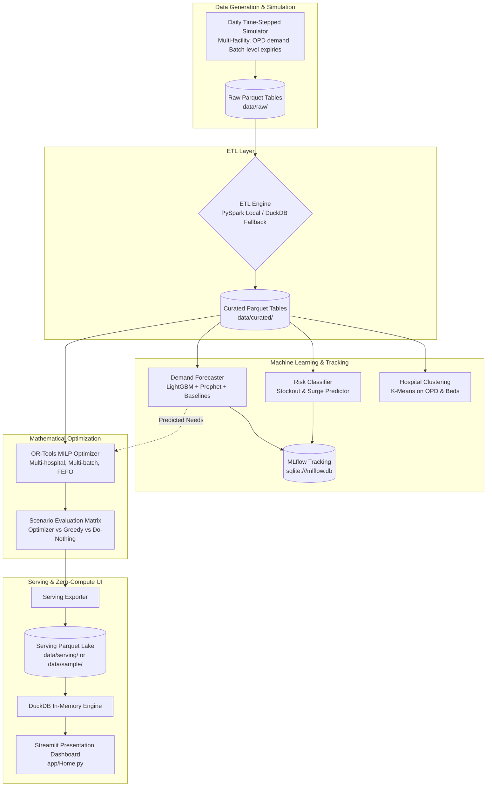

# Smart Medicine Redistribution System for Government Hospitals

[](https://github.com/AthulJithVasudev/Smart_medicine_distribution_system/actions)
[](https://www.python.org/downloads/)
[](https://share.streamlit.io)

> **An end-to-end data mining, demand forecasting, and MILP optimization platform that eliminates hospital drug stockouts and minimizes medicine expiry wastage across public healthcare networks.**

---

### 🌐 Live Demo & Interface Preview

- **Live Streamlit App:** `<LIVE_APP_URL>` *(Instant access powered by bundled sample serving data)*
- **Dashboard Preview:**

```text
+-------------------------------------------------------------------------------------------------------+
|  SMART MEDICINE REDISTRIBUTION SYSTEM  |  Role: [ Government Health Officer v ]   [ Guided Tour (5) ] |
+-------------------------------------------------------------------------------------------------------+
|  [!] What Needs Attention Now        |  [->] What Should Be Done             |  [#] What It Achieves  |
|  - Imminent Stockouts: 3 hospitals   |  - Transfer: H02 -> H05 (Amoxicillin) |  - Wastage Saved: 100% |
|  - Expiring Batches: 5 batches       |  - Transfer: H01 -> H08 (Paracetamol) |  - Fill Rate: 99.2%    |
|  - Critical Shortage Alert: High     |  - [Download Transfer Orders (CSV)]   |  - Cost: Rs. 1,08,622  |
+-------------------------------------------------------------------------------------------------------+
```

---

## ⚡ Quick Start in Three Commands

### Option A: Instant Dashboard (Zero Pipeline Run)
Clone and launch immediately with the bundled, precomputed sample dataset:
```powershell
git clone https://github.com/AthulJithVasudev/Smart_medicine_distribution_system.git
cd Smart_medicine_distribution_system
pip install -r requirements.txt
streamlit run app/Home.py
```

### Option B: One-Command Full Pipeline Run & Launch
To verify your environment, execute the end-to-end data pipeline, and launch the dashboard:

**Windows (PowerShell):**
```powershell
.\run_demo.ps1
```

**Linux / macOS (Bash):**
```bash
chmod +x run_demo.sh
./run_demo.sh
```

---

## 🎯 What You Can Do in the Dashboard

1. **Take Immediate Action:** View top critical shortages and expiring batches on the Home page, review recommended inter-hospital transfers with plain-language justifications, and download actionable transfer manifests as CSV.
2. **Empower Facility Administrators:** Switch to the Hospital Administrator view to inspect local inventory health, view 14-day forecasts with 95% uncertainty bands, and track incoming deliveries.
3. **Stress-Test Public Health Scenarios:** Benchmark **Smart Plan** (MILP) against **Nearest Surplus** (Greedy) and **Do Nothing** across 7 real-world scenarios (monsoon surges, 4x dengue epidemic, supply disruptions).
4. **Audit Historical Accuracy:** In the Replay tab, travel back in time to audit what the model predicted on any past date against realized patient demand.
5. **Verify Rigorous Model Metrics:** Review quantitative verdicts on Model Evaluation (WAPE error reduction, stockout classification recall, OPD feature ablation, and theoretical Oracle bounds).

---

## 🏗️ System Architecture

The system operates a closed-loop intelligence architecture with strict separation between heavy offline compute (PySpark/DuckDB ETL, LightGBM, OR-Tools MILP) and lightweight online presentation (Streamlit querying Parquet via DuckDB):



---

## 🛠️ Technology Stack

| Layer | Technologies | Purpose |
| :--- | :--- | :--- |
| **Language & Environment** | Python 3.12 (compatible 3.14), PowerShell, Bash | Core runtime and automated runner scripts |
| **Distributed & Local ETL** | Apache Spark (PySpark 3.5), DuckDB 1.x, PyArrow | Ingestion, temporal window features, zero-JVM fallback |
| **Predictive Modeling** | LightGBM, Statsmodels (SARIMAX), Scikit-Learn | Demand forecasting, stockout classification, K-Means clustering |
| **Mathematical Optimization** | Google OR-Tools (`pywraplp` CBC/SCIP MILP) | Constrained multi-facility batch-level redistribution |
| **Experiment Tracking** | MLflow with SQLite backend (`mlflow.db`) | Hyperparameters, metric tracking, model registry |
| **Analytical Serving & UI** | Streamlit, Plotly, DuckDB, OpenStreetMap | Interactive, zero-compute executive dashboard |
| **Testing & CI/CD** | Pytest, GitHub Actions (Ubuntu, Java 17, Python 3.12) | Automated test suite (74+ tests) and workflow automation |

---

## ⚙️ Execution Commands

### Primary One-Command Tools
```powershell
# Environment diagnostic & system check
python -m pipeline doctor

# Complete demo pipeline (prepare -> train -> scenarios -> export)
python -m pipeline demo --profile dev --seeds 1

# Launch the Streamlit dashboard
python -m pipeline app
```

### Advanced Stage-by-Stage Commands
For research experiments or fine-grained parameter tuning:
```powershell
# 1. Historical Data Generation & PySpark/DuckDB ETL
python -m pipeline prepare --profile dev

# 2. Train Demand Forecasters, Classifiers, and log to MLflow
python -m pipeline train --profile dev

# 3. Closed-Loop Scenario Matrix Evaluation
python -m pipeline run_scenario --scenario normal --policy optimizer --profile dev --seeds 1
python -m pipeline run_scenario --scenario all --policy all --profile dev --seeds 3

# 4. Export Analytical Serving Parquet Tables
python -m pipeline export --profile dev --target-dir data/serving

# 5. Execute Full Test Suite
pytest -ra
```

---

## ⚠️ Academic Disclaimer & Limitations

### Data Disclaimer
All hospital facilities, patient prescription records, inventory levels, Out-Patient Department (OPD) visits, and batch codes are **SYNTHETIC DATA** generated reproducibly from fixed random seeds by the daily time-stepped simulation engine for academic research. All records carry provenance tags (`SIMULATED`, `DERIVED`, `OFFICIAL`).

### System Limitations
1. **Simulation Calibrations:** Patient demand and epidemic dynamics depend on synthetic epidemiological distributions; real-world deployment requires integration with state HMIS/e-Aushadhi systems.
2. **Cost Parameters:** Penalty multipliers for critical drug shortages and transport costs per kilometer are representative assumptions calibrated to public health literature.
3. **Distributed vs. Local Spark:** PySpark executes in local mode for reproducible single-machine evaluation; it demonstrates API correctness rather than multi-node cluster speedup.
4. **Zero-Compute Serving:** The Streamlit dashboard visualizes precomputed batch pipeline runs and does not perform active online retraining.

---

## 📚 Detailed Documentation

Detailed architectural, mathematical, operational, and presentation guides are available in the [`docs/`](docs/) directory:

- 📐 [**Architecture & Mathematical Formulation**](docs/ARCHITECTURE.md) - Full MILP model, objective terms, constraints, and component interactions.
- 📖 [**User & Navigation Guide**](docs/USER_GUIDE.md) - Page-by-page walkthrough, role views, status badge conventions, and guided tour steps.
- 💻 [**Developer & Contributor Guide**](docs/DEVELOPER.md) - Codebase structure, CLI subcommands, adding scenarios, and Streamlit Cloud deployment.
- 🔧 [**Troubleshooting Guide**](docs/TROUBLESHOOTING.md) - Resolving Java/JVM missing, Windows winutils, port conflicts, and environment variables.
- 📊 [**Data Dictionary**](docs/DATA_DICTIONARY.md) - Auto-generated column definitions and schemas for all 12 serving Parquet tables.
- 🎓 [**Viva Presentation & Demo Script**](docs/DEMO_SCRIPT.md) - 5-minute examination demo script and answers to 6 tough viva questions.
- 🔬 [**Claims-to-Evidence Matrix**](docs/CLAIMS_TO_EVIDENCE.md) - Direct mapping of every research claim to empirical metrics and passing unit tests.
